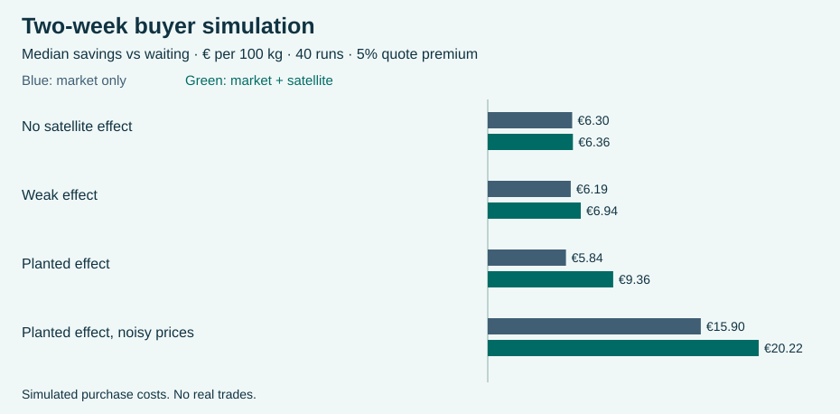

# OceanAlpha Atlantic

Can a satellite map help a seafood buyer decide whether to lock in a sardine price two weeks ahead?

## The buyer decision

A buyer needs 100 kg of sardines in two weeks. The simulated supplier quote is 5% above the last known auction price. Lock it if the forecast is higher than the quote. Otherwise, wait and pay the auction price. We compare a forecast using past prices and season with the same forecast plus satellite chlorophyll off Peniche, Portugal.

In the first simulation with a built-in link between chlorophyll and price, the satellite-guided rule saved €10.47 per 100 kg on average compared with always waiting. The market-only rule saved €6.58. The extra savings from adding the satellite data were €3.90 per 100 kg, calculated before rounding.

## Repeated two-week tests



At a 5% supplier premium, adding satellite data beat the market-only buyer in 8 of 40 runs with no planted effect, 34 of 40 with a weak effect, 40 of 40 with the stronger effect, and 37 of 40 with the stronger effect plus more price noise. Across all quote premiums and scenarios, we ran 480 comparisons.

The [NASA Aqua MODIS chlorophyll grid](data/modis_8day.csv) is real. The weekly auction prices and supplier quotes are simulated. These savings show how the buying rule behaves under different assumptions. Real weekly auction prices are needed to test whether the rule saves a buyer money at Peniche. The committed runs use no vessel data.

## Reproduce

```bash
python -m pip install -r requirements.txt
python buyer_stress_test.py
```

- [Two-week hackathon pitch and vessel-data status](TWO_WEEK_PITCH.md)
- [Summary by scenario and supplier premium](results/buyer_summary.csv)
- [All 480 runs](results/buyer_runs.csv)
- [NASA satellite dataset metadata](https://coastwatch.pfeg.noaa.gov/erddap/griddap/erdMH1chla8day_R202SQ.html)
- [Original project plan](PROJECT_PLAN.md)
