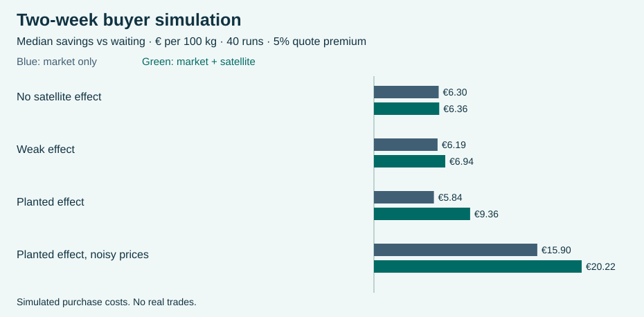

# OceanAlpha Atlantic · Two-week pitch

A buyer needs 100 kg of sardines in two weeks. Should they lock in a quote today or wait for the auction?

1. Show the real NASA Aqua MODIS chlorophyll map off Peniche. Explain that the model uses measurements already available on the forecast date.
2. Show the two simulated price forecasts side by side. One uses price history and season. The other also uses satellite chlorophyll.
3. Lock if the forecast is above the supplier quote. Otherwise wait. Reveal the simulated auction price and compare what the buyer would have paid.
4. Across 103 held-out weeks with a deliberately built-in price link, average simulated savings versus waiting were €10.47 per 100 kg with satellite data and €6.58 without it. With the link removed, adding satellite data gave no extra savings.

**Make the invisible visible** with the observed ocean map. **HRT** gets the forecast, decision and cost comparison. Weekly auction prices and supplier quotes in this demo are simulated.

## Independent test with vessel activity

The next test asks whether satellite chlorophyll improves predictions of detected fishing-vessel visits to Peniche during delivery week two. The target is an AIS-derived visit count, which does not identify sardines, tonnes landed or auction prices. The Global Fishing Watch Events API returned HTTP 401 without a valid token, so there are no observed vessel results to present yet.

If you have an export, filter to Peniche fishing vessels using the verified anchorage IDs, deduplicate by event ID, and count visit starts by UTC week. Use complete, consistently covered weeks, including a zero only for a covered week with no detected visits. Omit weeks with unknown coverage. Record the dataset version, dates and vessel filter. Supply a CSV with columns week (Monday UTC) and detected_visits (nonnegative integer), then run:

    python port_activity.py peniche_visits_weekly.csv

The script compares the last available count, a season-and-visit-history model, and the same model with satellite chlorophyll added. It uses a common held-out period and leaves one week for visit reporting. The reporting delay is an assumption.

Source: https://globalfishingwatch.org/datasets-and-code-anchorages/

## Repeated two-week buyer tests

Run `buyer_stress_test.py` with Python to reproduce 480 scenario/seed/quote combinations (4 price scenarios × 40 seeds × 3 quote premiums). The chart shows median simulated savings against always waiting. The table reports the median paired improvement and how often adding satellite data beats the market-only buyer.

[Summary CSV](results/buyer_summary.csv) · [Every run](results/buyer_runs.csv)

At the 5% supplier premium, the satellite buyer beat the market-only buyer in 8/40 runs with no planted effect, 34/40 with a weak effect, 40/40 with the planted effect, and 37/40 with the planted effect plus more price noise. The median paired gain was approximately €0.00, €0.77, €3.72 and €4.21 per 100 kg respectively. These are simulated purchasing savings under assumed supplier quotes, no fees and guaranteed fill. They are not observed profit.

The exact satellite grids are checked in. [Eight-day Aqua MODIS chlorophyll](data/modis_8day.csv) is the weekly model input. [Monthly Aqua MODIS chlorophyll](data/modis_chlorophyll.csv) and [monthly NASA/JPL MUR surface temperature](data/mur_temperature.csv) belong to the earlier annual experiment.

A verified AIS export can be supplied with `python buyer_stress_test.py --visits peniche_visits_weekly.csv --out results_with_ais`. It must cover every simulation week. The simulation uses the observed counts as an activity proxy and applies an assumed relationship between activity and price. The committed runs contain no AIS data because the historical port-visits endpoint required credentials. Detected visits would ground the activity proxy, but cannot establish fish imports, quantities, species, or prices.
